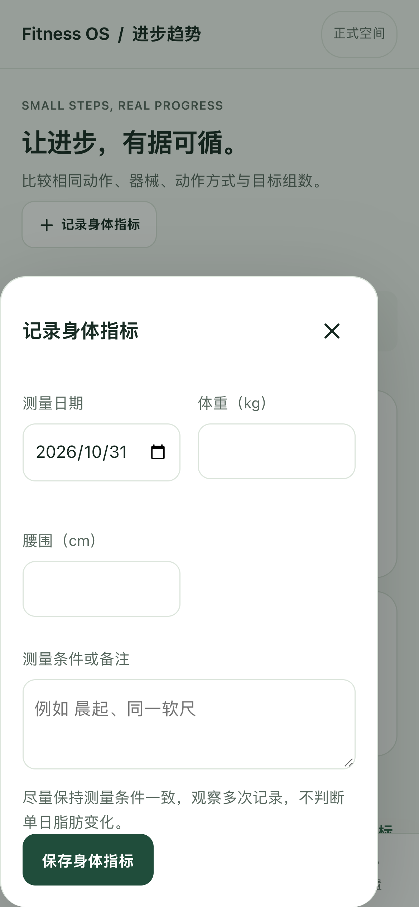
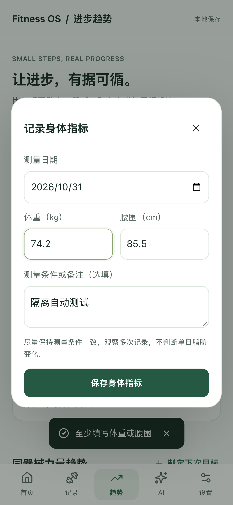
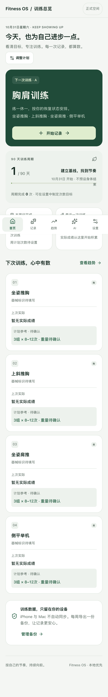

# Fitness OS V1.1.1 开发验收

本轮仅开发修复分支 `fix/fitness-os-v1.1.1-mobile`，不合并 main、不部署。基线为正式 V1.1 main `a454577a4ad29c14d2c88201c416a31c63a0f4bc`。

## 变更

- 打开即训练总览，移除欢迎选择、顶部空间标识及设置/AI的演示入口。只连接原 `fitness-os-real`，不读取旧模式偏好。
- 保留训练编辑器、默认 A/B/C 配置、草稿、历史、目标和完成总结。
- 每周次数全零显示紧凑空态；非零保留八周、统一柱底，次数标签贴近各柱顶，日期使用 MM/DD 且不换行。窄屏局部横向滚动，不裁掉周数，不产生页面横向滚动。周一开始、仅统计已完成训练的规则保持不变。
- 身体指标日期独占一行，体重/腰围通常并排，320px 单列；备注两行，全宽保存，关闭按钮44px，安全区留白，弹窗只保留一个滚动容器。
- 身体指标明细新增编辑入口，沿用原字段和 HTML 校验，更新保留原 ID/createdAt，仅更新相应记录和 updatedAt。
- 同类布局修复：窄弹窗居中，离线状态文字保持可见，空图表卡片不被相邻日历撑高。
- 构建标识与包版本改为1.1.1；现有无部署权限的开发检查增加 `fix/**` 触发。

## 数据兼容方案

原正式库和演示库按名字物理隔离，无需迁移。本版只连接 `fitness-os-real`，现有 `fitness-os-demo` 原样保留且没有入口；不合并、不扫描或删除来源不明记录，不清库、不改变 schema/version。旧偏好留在 localStorage 但不参与入口判断，因此旧演示用户也直接看到个人库。

`src/model.ts`、`src/db.ts`、`src/backup.ts`、`pnpm-lock.yaml`、正式 `.github/workflows/pages.yml` 与正式V1.1基线字节一致。保留内部 Mode/演示库兼容工具用于既有契约测试，生产组件没有模式状态、模式入口或自动加载演示数据的路径。JSON仍为旧版version 1及mode real；演示备份拒绝规则保留。

代码回滚可恢复V1.1文件树；没有数据库迁移需要回退，不应删除数据库或覆盖用户记录。升级/回滚测试仅操作临时 dist 与隔离浏览器，不触碰用户浏览器。

## 自动化与证据

最终结果见文末。完整截图在本机 `artifacts/v1.1.1/before/` 与 `artifacts/v1.1.1/after/`；before为实际V1.1构建复现，after为本次修复构建，均为隔离数据。关键390px截图随本报告保存在 `v1.1.1/`。

| 项目 | 范围 |
|---|---|
| 单元 | 24项；含跨月、跨年、零值、单周、多周、大次数、草稿排除 |
| 浏览器 | Chromium与WebKit；320/375/390/430px和1440px；五页深浅色、大字号、长文本 |
| 指标 | 空值、新建、小数、腰围、备注、编辑后刷新、历史显示 |
| 兼容 | 真实V1.0和V1.1构建升级至1.1.1再回滚，八表逐字段比较、历史及草稿保持 |
| 单空间 | 旧demo偏好忽略、无选择入口、无演示自动记录、独立旧库未知记录保持 |
| PWA | manifest、SW激活更新、离线冷开与编辑、进程重启、正式子路径、备份恢复 |

## 待真机验收与发布条件

自动化WebKit不等同真实iPhone Safari或主屏幕PWA。真实数字键盘弹出、动态工具栏、刘海/底部安全区、系统重启、下载文件选择和真人录入时间仍需用户在iPhone核对。自动化只验证inputmode和视口布局，不声称已验证真实键盘。

建议用户审阅图表/身体指标/首页截图并完成真机项目后，再确认发布V1.1.1。本轮没有修改正式站，不创建预览站点、Release或版本标签。

## 截图对比（390px，自动化隔离数据）

| 项目 | V1.1 基线 | V1.1.1 修复 |
|---|---|---|
| 每周训练空态 |  |  |
| 身体指标 |  |  |
| 训练总览 |  |  |

非零周次数： 

## 最终验收结果（2026-10-31）

- 单元测试：24通过、0失败。
- 最终完整浏览器回归：44通过、0失败、0跳过、0 flaky（约2分钟）；Chromium和WebKit各22项。此前测试脚本在旧版欢迎页/完成后导航及归档缓冲区上出现的问题已修正，最终全量重跑通过。
- TypeScript、根路径生产构建、正式 `/fitness-os/` 子路径生产构建均通过。
- 正式子路径PWA专项：Chromium、WebKit均通过；15项静态预缓存；manifest id/start_url/scope和图标正确，HTTPS安全上下文（本地安全回环）、SW范围正确，离线冷开、离线编辑、联网保留及资源响应检查通过。这是正式子路径候选构建验证，不是把1.1.1部署到线上后的验证。
- 数据兼容：V1.0、V1.1真实构建升级及代码回滚均通过；schema及备份实现未改动；独立旧演示库未知记录原样保留。
- 布局：四种手机宽度和桌面、深浅色、长文本与大字号检查通过；截图已复核。没有读取用户实际训练库。
- 本轮未合并main、未部署、未创建Release或版本标签。线上仍为V1.1。

建议：开发候选版可交用户进行真机验收；截图与真机确认后再另行授权发布。本轮不建议绕过真机确认直接上线。

## 修改文件清单

- `.github/workflows/v1.1-checks.yml`
- `README.md`
- `package.json`
- `vite.config.ts`
- `src/App.tsx`
- `src/analytics.ts`
- `src/mobile.css`
- `scripts/verify-subpath.mjs`
- `tests/v1.1.1.test.ts`
- `e2e/fixtures.ts`
- `e2e/fitness.spec.ts`
- `e2e/lifecycle.spec.ts`
- `e2e/mobile-v11.spec.ts`
- `e2e/mobile-v111.spec.ts`
- `e2e/upgrade-v11.spec.ts`
- `e2e/upgrade-v111.spec.ts`
- `docs/V1.1.1_ACCEPTANCE.md`
- `docs/v1.1.1/after-body-390.png`
- `docs/v1.1.1/after-overview-390.png`
- `docs/v1.1.1/after-weekly-390-dark.png`
- `docs/v1.1.1/after-weekly-390-light.png`
- `docs/v1.1.1/after-weekly-empty-390.png`
- `docs/v1.1.1/before-body-390.png`
- `docs/v1.1.1/before-overview-390.png`
- `docs/v1.1.1/before-weekly-empty-390.png`
